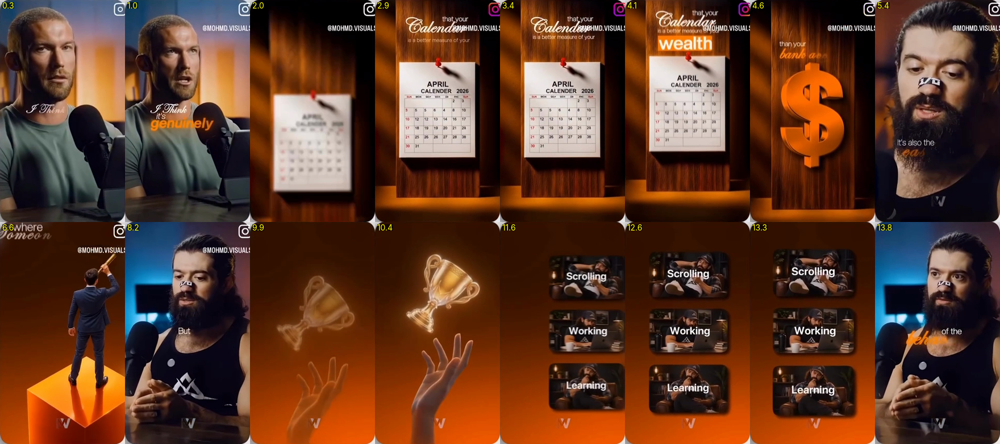

# Style: Amber Cinematic (warm orange + teal, 3D props)

Reference: the **result** side only of a "raw vs result" showcase (English podcast, ~14 s; the outro card is removed). `result-only.mp4`, `contact-sheet.png` and `frames/` are visual reference only (someone else's work, not for republishing).

## Overall feel
Premium "money / productivity" explainer. A **teal-and-orange colour grade** on the speaker, with frequent cuts to **full-screen glossy 3D prop scenes** on a deep burnt-orange background. Clean, modern and fast.

## Palette (sampled)
| Role | Hex |
|---|---|
| Teal shadow (grade) | `#163E63` / `#304878` |
| Skin/highlight warm | `#D89048` |
| Burnt-orange background | `#511E01` → `#9D3E00` → `#D84800` (vertical gradient, darker at the top) |
| Deep brown | `#351200` |
| Accent orange text | `#FF7A1A` → `#FFA040` |
| Wood (prop scenes) | `#783000` / `#A84800` |
| Text | white `#FFFFFF`, small grey `#D9D9D9` |

## Typography
- **Mixed pair**: a thin italic script/serif (e.g. "Playfair Display Italic", "Pinyon Script") for the soft words («I Think», «Calendar», «Someone's»), then **heavy bold sans in orange** for the key word («genuinely», «wealth», «5 years»).
- Small regular sans lines in between («that your», «is a better measure of your»).
- **Arabic equivalent**: Amiri Italic-style / Aref Ruqaa for the soft words, Cairo Black orange for the key word.
- Captions are small, 1–3 words, placed mid-chest or beside the face, never in a bottom bar.

## Scenes and motion
1. **Speaker, graded**: teal/orange grade, light vignette; text pops beside him (soft word fades in, key word punches in with an orange glow).
2. **Prop on wood**: a calendar pinned to a wooden board, a camera push-in with a focus pull from blurred to sharp, and words above.
3. **3D symbol**: a big glossy orange object (a $ sign) rising in.
4. **Hero on pedestal**: a small figure on an orange cube looking up through a telescope, with text at the top.
5. **Trophy + hand**: a glowing gold trophy floating above a reaching hand, which fades in from blurred to sharp.
6. **UI cards**: three rounded image cards with labels («Scrolling / Working / Learning») sliding in from the right one after another, slightly overshooting.
7. **Lens-flare burst**: a bright orange/pink flare whiting out the frame as a transition.

Motion is smooth easing with slight overshoot, focus pulls, a parallax push-in and a glow bloom on the key words. Each cut lasts 1–2 s.

## How to use
Say: "edit with the **amber-cinematic** style (styles/amber-cinematic)". Build on `styles/cinematic-gold/engine`: change the background to the orange gradient, add a teal/orange grade to the speaker (ffmpeg `colorbalance` / `curves`), the script + bold-orange text pair, and card / flare scene types. The 3D props need generated or stock images.
