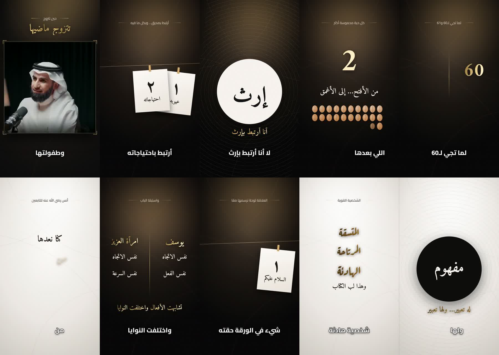

# Style: Cinematic Gold (the style of the "كيف تبني علاقات ناجحة؟" reels)

Used for the six Dr. Yasser Al-Huzaimi reels (Oct 2026). Inspired by a dark-and-gold kinetic typography reference.



## Layout (1080×1920)
- **Background**: dark charcoal radial gradient (`#1F1C19` → `#100F0E` → `#060606`) with a warm gold spotlight at the top, faint gold arcs, a drifting light leak and light film grain.
- **Speaker panel**: a 990×990 square at x=45, y=450, with a thin gold border (`rgba(226,196,124,.75)`), corner brackets and a deep shadow. The square crop avoids burned-in subtitles and low-resolution sources.
- **Headline zone** (top, y≈105–435): a small kicker line with gold rules on both sides (Cairo 500) above a large **gold gradient** headline (Amiri Bold).
- **Caption zone** (y≈1560–1740): Cairo ExtraBold, white with a black outline, one line, no box; words appear as they are spoken.
- **Identity tag**: speaker name and show name at the bottom-left of the panel for the first 4 s.

## Colours
| Role | Value |
|---|---|
| Gold gradient | `#8A6A2F → #E9CF8A → #FFF3C9 → #C9A253 → #8A6A2F` (animated shimmer) |
| Gold line | `#E2C47C` |
| Dark scene | `#3A3128 → #17140F → #070707` |
| Light scene | `#FBFAF7 → #E9E6E0 → #CFCBC3`, with bronze gold `#4A3410 → #B8893A` |
| Muted text | `#D8D2C6` |

## Motion
- Headline words reveal one by one (or on the spoken word via `ats`): blur 10 px → 0, rising 22 px, 0.55 s.
- Cutaways fade in and out over 0.28 s; a cutaway that ends the reel stays solid to the last frame.
- Back-to-back cutaways overlap so the speaker never flashes between them.

## Cutaway scene types (`cuts[].type`)
| Type | Description | Key fields |
|---|---|---|
| `word` | disc with concentric rings and a big word, optional gold sub-line | `text`, `size`, `sub`, `subAt`, `theme` |
| `cards` | clothesline with numbered paper cards that swing in | `cards[{n,label,x,y,r,at,flash}]` |
| `counter` | big gold number with steps or a count, label, optional bean grid | `steps[{at,v}]` or `from/to/countAt/countDur`, `label`, `beans`, `beansTop` |
| `versus` | two columns split by a gold line, optional bottom line | `left[]`, `right[]` (`text,size,gold,at`), `bottom{text,at,top,size}`, `lineH` |
| `tear` | paper card that tears into two halves | `text`, `tearAt` |
| `lines` | stacked typographic lines (dark or light), Amiri or Ruqaa | `lines[{text,at,size,font,plain}]`, `top` |

All `at` values are seconds from the cut's `t0`. Headline `ats` are absolute reel seconds.

## Pipeline
```bash
pip install faster-whisper            # word timings (large-v3)
npm i playwright                      # or set PLAYWRIGHT_PATH to an existing install
python engine/cut_panel.py source.mp4 examples/ranges.json r2 panel_r2.mov
bash engine/make_reel.sh examples/r2.py panel_r2.mov reel2.mp4   # also writes reel2.srt
node engine/render.js spec.json panel.mov x --frames 1.5,6.5 --png-dir previews   # quick stills
```
A reel definition (`examples/r*.py`) has `duration`, `words` (`word@time`, with `|` to force a caption break), `headlines` and `cuts`.

## Lessons learned
- Don't feed PNG sequences straight into the ffmpeg 6.1 overlay: frames get dropped. Convert them to an alpha video (qtrle) first and check the frame counts.
- Check spelling against several sources (Whisper, YouTube ASR, burned-in subtitles), and cut only in silences confirmed on the audio.
