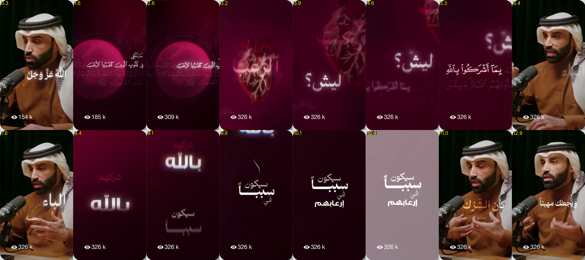

# Style: Crimson Kinetic (crimson kinetic typography)

Reference: the "After" side of a before/after showcase reel (13.6 s, Arabic religious/talk content).
`after-only.mp4`, `contact-sheet.png` and `frames/` are kept as visual reference only. They are someone else's work; don't republish them.

## Overall feel
Emotional, spiritual, dramatic. The speaker is shown **full-screen** (portrait fill, no panel), alternating with **full-screen crimson typographic scenes**. Text is large, glowing and moves fast, with motion blur. Cuts land on key words.

## Palette (sampled)
| Role | Hex |
|---|---|
| Deep background (darkest) | `#160000` / `#170008` |
| Maroon base | `#38000D` / `#310018` |
| Crimson mid | `#54001F` / `#5E0023` |
| Wine shadow | `#730A35` |
| Glowing sphere / moon | `#BF698E` → `#E04A7E` core, soft edges |
| Pink highlight text | `#DB8995` / `#E3CEDF` |
| Flash / pale-pink wash | `#988089` (one-frame flash transition) |
| Keyword on speaker (warm) | gold-orange `#E39A55` → `#A9623E` gradient |
| Main text | white `#FFFFFF` with a soft pink-white glow |

Background = radial gradient from maroon `#54001F` at the centre to near-black `#160000`, plus heavy vignette and fine grain.

## Typography
- **Big keywords**: heavy Arabic display (Cairo Black / Lalezar style), white, glow (`0 0 12px #fff, 0 0 30px #ff6fa0`), with a slight **chromatic aberration** (red/cyan offset 2–3 px) on entry.
- **Quranic verse**: Uthmani/Naskh script (Amiri Quran / KFGQPC Uthmanic) with diacritics, in white, with the ayah-number marker ۝; the non-active lines dimmed to ~25 %.
- **Stacked hierarchy**: words stacked at different sizes on separate lines: small «سيكون» → huge «سبباً» → small «في» → bold «إرعابهم».
- **Secondary word** above the main word in muted pink, small (e.g. «شركهم» over «بالله»).
- **On the speaker shot**: key word in gold-orange gradient with glow, beside the head (e.g. «كأن الشِّرك», «الباء»), with a small label line under it.

## Motion
- **Word entry**: fast slide in (vertical or diagonal) with **directional motion blur** (8–16 px) settling in ~0.25 s, plus a slight overshoot; glow flares then settles.
- **Camera drift / shake**: subtle scale (1.00 → 1.06) and a 1–2 px jitter on text scenes.
- **Text swaps**: the old word blurs out upwards while the new one blurs in from below; the previous line ghosts at 20 % opacity.
- **Flash transition**: a 2–3 frame pale-pink wash (`#988089`) at the climax word, then back to dark.
- **Hand-drawn accent**: a thin white curved stroke that draws itself (stroke-dashoffset) towards the next word.
- **Speaker ↔ scene cuts**: hard cuts on the beat, no crossfade; sometimes a blur-zoom into the scene.
- **Captions on speaker**: white bold words, 1–3 words at a time, placed beside the face (not at the bottom).

## Scene types to build
1. **Verse scene**: crimson background, a big blurred glowing pink sphere at the left, verse lines at the right, the active phrase bright and the rest dim.
2. **Symbol scene**: a large illustrative object (e.g. an anatomical heart, in red line-art) behind a giant glowing keyword.
3. **Question scene**: one huge word with a question mark («ليش؟») blurring in and out.
4. **Stack scene**: a vertical multi-size word stack on a dark crimson background.
5. **Flash beat**: a pale-pink wash with the stack still visible.
6. **Speaker + keyword**: the full-screen speaker with a gold-orange glowing keyword beside the head.

## Audio cues (inferred)
Deep whoosh on every text entry, a low boom/hit on the flash beat, a soft ambient pad underneath.

## How to use
Say: "edit with the **crimson-kinetic** style (styles/crimson-kinetic)". The renderer in `styles/cinematic-gold/engine` can be adapted: swap the colour tokens, add motion blur and a chromatic offset to the word entries, and add the sphere/flash scene types.
