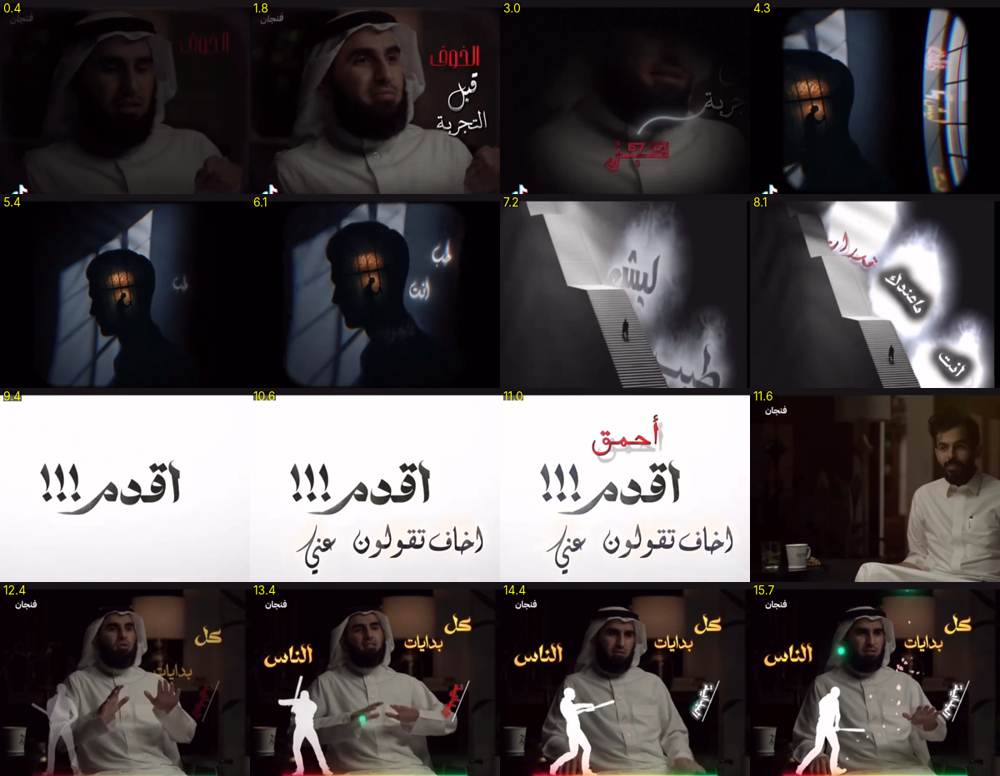

# Style: Noir Surreal (dark, surreal, Arabic calligraphy)

Reference: an Arabic talk/podcast edit (16 s, 576×448), the whole clip. `reference.mp4`, `contact-sheet.png` and `frames/` are visual reference only (someone else's work, not for republishing).

## Overall feel
Moody, introspective, poetic. Low-key dark footage, with cuts to **surreal symbolic scenes** (a silhouette with a glowing window in the head, an endless staircase into white light) and a **clean white calligraphy card** as the emotional peak. It then returns to warm speaker shots with **gold words and a white silhouette figure** that acts out the idea.

## Palette (sampled)
| Role | Hex |
|---|---|
| Near-black | `#0A070A` / `#020002` |
| Dark warm shadow | `#433028` |
| Night blue (window light) | `#384552` |
| Blood red (key word) | `#901818` / `#C03030` / `#D81818` |
| Warm amber window | `#A86048` / `#904830` |
| Paper white | `#FFFDFE` / grey `#908E8F` |
| Gold words | `#F0C060` → `#C09048` → `#906030` |
| Accent glow | neon green `#3CFF7A` particles, magenta/orange light leak |

## Typography
- **Arabic calligraphy / brush style** (Diwani, Thuluth-like, or a brush font such as "Aref Ruqaa", "Reem Kufi Ink", "Lalezar"), mixed sizes, slightly tilted and overlapping.
- **Key emotional word in blood red** (الخوف، أحمق), the rest white (on dark) or black (on white).
- **On the white card**: big black brush text with a soft grey shadow, punctuation for emotion («أقدم!!!»), and a smaller line below («أخاف تقولون عني»). A red word drops in on top as the punch («أحمق»).
- **On the speaker**: gold-yellow bold words stacked beside him («كل / بدايات / الناس»), plus a small red rotated tag word with a thin white slash line.

## Scenes and motion
1. **Speaker, dimmed**: dark vignette; words write or fade in beside the face; a thin white hand-drawn curve connects two words.
2. **Silhouette window**: a profile silhouette whose head contains a lit window with a tiny figure (an idea or memory), lit by blue window light, with a light chromatic glitch at the edge.
3. **Endless stairs**: a monochrome staircase rising into white fog, a tiny figure climbing, and words floating in the mist («ليش»، «ماعندك»، «أنت»).
4. **White calligraphy card**: a flash to white, then text stamps in with a small shake and a soft shadow; elements add one by one.
5. **Light-leak transition**: an orange/magenta burst over a cut to a new speaker.
6. **Silhouette figure**: a white cut-out figure (e.g. a batter swinging) animated beside the speaker to visualise the metaphor, with green spark particles at the impact.

Pacing: 1–2 s per beat. Transitions: flash to white, light leak, quick blur. Grain and vignette throughout.

## How to use
Say: "edit with the **noir-surreal** style (styles/noir-surreal)". Build on the engine in `styles/cinematic-gold/engine` by swapping in a dark/red/gold palette, brush fonts and new scene types (white card, silhouette, stairs). Symbolic images (silhouette, stairs, figure) need generated or stock images, or simple vector shapes.
