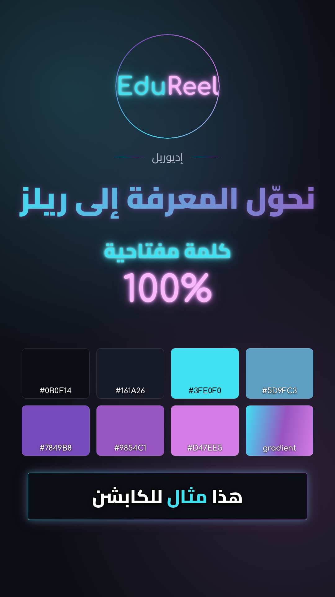

# EduReel brand kit (إديوريل · @edureel.studio)

Colours and styles sampled from the EduReel Instagram logo, for use in future video edits.

## Palette

| Role | Hex | Use |
|---|---|---|
| Background | `#0B0E14` | page / video background |
| Logo background | `#11131C` | panels, cards |
| Surface | `#161A26` | raised panels |
| Line | `#2B2F37` | dividers, subtle borders |
| **Cyan** | `#3FE0F0` | key words, active caption word, "Edu" |
| Cyan soft | `#6ACDDB` | secondary cyan |
| Cyan glow | `#AEFFFF` | glow core |
| Blue | `#5D9FC3` | transitions between cyan and purple |
| **Violet** | `#7849B8` | deep accent |
| **Purple** | `#9854C1` | icon, secondary headlines |
| Purple glow | `#E2B3FC` | glow core |
| **Magenta** | `#D47EE5` | numbers, payoffs, "Reel" |
| Magenta glow | `#F8B8F9` | glow core |
| Text | `#FFFFFF` / muted `#B9BCC8` | |

Brand gradient: `#3FE0F0 → #9854C1 → #D47EE5` (cyan → purple → magenta).

## Fonts (in `fonts/`, both OFL)
- **Cairo**: Arabic captions (800), headlines (900), labels (500)
- **Comfortaa**: Latin text, a rounded geometric style close to the EduReel wordmark

## Look and motion
- Neon glow on deep navy, with thin glowing rings, orbit lines and soft light particles
- Words reveal one by one: blur → sharp with a slight rise (~0.5 s)
- Colour accents: cyan for key words, magenta for numbers and payoffs, purple for secondary lines
- Captions: white Cairo ExtraBold with a black outline, one line, no box; active word in cyan
- Video frame: thin cyan→magenta gradient border with a soft outer glow

## Files
- `theme.json`: all tokens (colours, gradients, glows, fonts, motion notes)
- `edureel.css`: drop-in CSS variables and classes (`.er-bg-glow`, `.er-grad-text`, `.er-neon-cyan/purple/magenta`, `.er-caption`, `.er-frame`, `.er-ring`, `.er-rule`)
- `captions-theme.json`: caption theme in the arabic-reels format (font paths are relative to this folder)
- `preview.html` / `preview.png`: visual reference
- `logo-reference.png`: logo crop from the profile screenshot (low resolution, for reference only)

To use it: ask Claude to "use the EduReel brand kit in `brand/edureel`" when editing a video.
